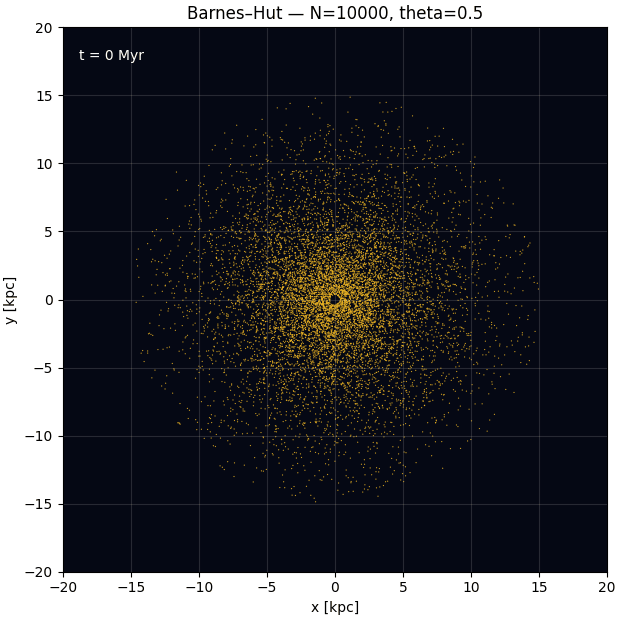

# GalaxyDynamicsLab

Laboratório didático de dinâmica galáctica desenvolvido em Python, com foco em
simulações N-body bidimensionais, autogravidade e experimentos reprodutíveis.

O projeto começou com uma minigaláxia calculada por soma direta e evoluiu para
um Tree Code Barnes–Hut. O objetivo não é reproduzir toda a formação de uma
galáxia real, mas investigar como gravitação, condições iniciais e parâmetros
numéricos produzem órbitas, braços espirais, barras e redistribuição de momento
angular.



## Modelo atual

Cada partícula representa um elemento de massa do disco estelar. A aceleração é
composta por um halo de Plummer fixo e pela autogravidade suavizada do disco:

$$
\mathbf a_i =
-\nabla\Phi_h(\mathbf r_i)
+G\sum_{j\ne i}m_j
\frac{\mathbf r_j-\mathbf r_i}
{\left(\lvert\mathbf r_j-\mathbf r_i\rvert^2+\epsilon^2\right)^{3/2}}.
$$

O halo é descrito por

$$
\Phi_h(r)=-\frac{GM_h}{\sqrt{r^2+a_h^2}}.
$$

A evolução temporal usa Leapfrog na forma kick–drift–kick. No Tree Code, uma
célula de tamanho $s$ e distância $d$ é aproximada pelo seu monopolo quando

$$
\frac{s}{d}<\theta.
$$

## Notebooks

| Notebook | Objetivo | Estado |
|---|---|---|
| `01_minigalaxia_nbody_colab.ipynb` | Soma direta, halo fixo, autogravidade e primeira animação | Congelado |
| `02_barnes_hut_treecode_colab.ipynb` | Validação do Barnes–Hut contra a soma direta e teste com $N=10000$ | Congelado |
| `03_laboratorio_barnes_hut.ipynb` | Convergência, estabilidade, modos de Fourier e estudos paramétricos | Em desenvolvimento |

Os notebooks congelados preservam a implementação e as validações iniciais.
Resultados maiores são armazenados separadamente para evitar inflar o histórico
do Git.

## Estrutura

```text
GalaxyDynamicsLab/
├── figures/                 # Figuras e GIFs selecionados
├── notebooks/               # Cadernos de estudo
├── results/                 # Resumos versionados; dados brutos são ignorados
├── scripts/                 # Benchmark e futuras execuções em lote
├── src/minigalaxy/          # Motor numérico reutilizável
├── .gitignore
├── requirements.txt
└── README.md
```

O arquivo `src/minigalaxy/bh_engine_v1.py` contém apenas a física e os métodos
numéricos. Gráficos, GIFs, títulos, limites dos eixos e comparações permanecem
nos notebooks.

## Instalação local no Windows

Na raiz do repositório:

```powershell
py -m venv .venv
.\.venv\Scripts\python.exe -m pip install --upgrade pip
.\.venv\Scripts\python.exe -m pip install -r requirements.txt
```

No VS Code, selecione `.venv` como kernel dos notebooks.

## Benchmark

```powershell
.\.venv\Scripts\python.exe scripts\benchmark.py
```

O benchmark aquece o Numba separadamente e mede três execuções curtas com
$N=10000$. No primeiro computador testado localmente, a mediana para 50 passos
foi 3,125 s, resultando em uma estimativa de 62,5 s para 500 Myr. O mesmo caso
levou aproximadamente 100 s no Google Colab gratuito. Esses tempos dependem da
CPU, temperatura e evolução da árvore.

## Política de resultados

- Código, configurações, resumos e figuras selecionadas entram no Git.
- Arquivos `.npz`, frames e resultados brutos ficam em `results/raw/`.
- Cada resultado registra configuração, semente, versão do motor, versões do
  NumPy e Numba e horário de criação.
- GIFs são gerados a partir dos arquivos `.npz`; alterar a apresentação não
  executa novamente a simulação.

## Limitações

O modelo atual é bidimensional, colisional apenas no sentido numérico das
partículas suavizadas, sem gás, formação estelar, bojo explícito ou halo vivo.
Classificações morfológicas como Sb ou SBb são, portanto, comparações visuais e
dinâmicas, não classificações observacionais completas.

